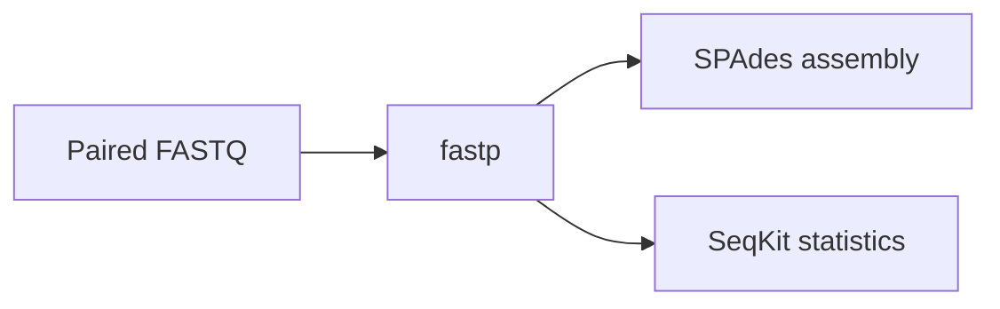

# Paired-end read processing with Nextflow

**Trim paired reads with fastp, then run SPAdes assembly and SeqKit statistics as parallel downstream branches.** A small Nextflow DSL2 coursework workflow associated with Georgia Tech BIOL 7210, Spring 2025.



One read pair dataset is processed per run. Both downstream tasks depend on cleaned reads; the graph permits concurrent execution, subject to the executor's available resources.

## Run in the verified environment

Requirements: Docker with Linux amd64 support (emulation is needed on Apple Silicon). Allow at least 6 GB of Docker memory. The image includes Nextflow 24.10.5, Java and the three command-line tools, so no host Nextflow or nested Docker daemon is required.

```sh
git clone https://github.com/hayannacho/my_first_wf.git
cd my_first_wf
docker build --platform linux/amd64 -t nextflow-course .
docker run --rm --platform linux/amd64 -v "$PWD:/project" -w /project nextflow-course
```

By default, the workflow reads `data/mini_1.fastq` and `data/mini_2.fastq` relative to the project directory and writes new products to `output/`. The included subset has **5,000 reads per mate**. The original README attributes it to ENA accession [ERR1755086](https://www.ebi.ac.uk/ena/browser/view/ERR1755086); this review verified its byte identity with the course archive, not its original subsampling procedure. It is not synthetic data.

To use your own **Phred+33** paired-end FASTQ files inside the mounted project folder:

```sh
docker run --rm --platform linux/amd64 -v "$PWD:/project" -w /project nextflow-course \
  run main.nf --read1 data/sample_1.fastq --read2 data/sample_2.fastq --outdir output-sample
```

The current defaults use two CPUs per task and a 4 GB SPAdes memory setting. They are suitable for the small examples, not a resource recommendation for full genomes. Input paths are checked before task execution.

## Synthetic demonstration

Generate 300 artificial 150-base read pairs from a 1,500-base artificial sequence, then run the same workflow:

```sh
docker run --rm --platform linux/amd64 --entrypoint python3 \
  -v "$PWD:/project" -w /project nextflow-course examples/generate_reads.py

docker run --rm --platform linux/amd64 -v "$PWD:/project" -w /project nextflow-course \
  run main.nf --read1 examples/generated/reads_1.fastq \
  --read2 examples/generated/reads_2.fastq --outdir output-synthetic

docker run --rm --platform linux/amd64 --entrypoint python3 \
  -v "$PWD:/project" -w /project nextflow-course tests/check_outputs.py output-synthetic
```

The synthetic example has no biological sample provenance and is only an execution check.

## Outputs

```text
output/
  clean_1.fastq
  clean_2.fastq
  seqkit_stats.txt
  spades_output/
    contigs.fasta
    ... SPAdes logs and intermediate files
```

The `results/` tree is a committed **historical coursework output**, not the result of a new run or proof of current validation:

```text
results/
  clean_1.fastq          fastp output
  clean_2.fastq
  seqkit_stats.txt
  spades_output/
    contigs.fasta        2 contigs, 37 and 34 bp
    params.txt           SPAdes 3.15.3, --careful
    spades.log
```

It has been pruned to the final products and the run record. The 91 SPAdes working files it also held — per-k `configs/*.info`, `pipeline_state/` markers, assembly graphs, BWA indexes, error-corrected reads and mismatch-corrector output — are tool internals and were removed; they remain in the Git history. The original publishing configuration nested these under `results/spades_output/spades_output/`, and that duplicated directory level is gone here as well.

The archived `contigs.fasta` holds two low-complexity contigs of 37 and 34 bp. That is what SPAdes produces from a 5,000-read subset: it records what the workflow ran, not a usable assembly.

New runs write to the separate `output/` tree. Generated output and work files are ignored by Git. Reusing an output directory replaces corresponding published files; use a new `--outdir` when comparing runs.

## Other execution options

With Java, Nextflow 24.10.5, fastp, SPAdes and SeqKit already installed:

```sh
nextflow run main.nf
nextflow run main.nf -resume
```

The original per-process BioContainers profile is retained:

```sh
nextflow run main.nf -profile docker
```

That profile uses the older image tags specified in `main.nf`; it was not rerun in this review. The verified route is the supplied single-container environment above. Do not add `-profile docker` inside that image: it has no nested Docker daemon. `flow.png` is the historical workflow illustration; it is not a fresh execution receipt.

## Verification and limits

The original workflow and the revised workflow were executed with real fastp, SPAdes and SeqKit. The revised workflow was checked on both the archived read subset and synthetic inputs. All three stages completed successfully, with paired output FASTQ, a SeqKit report and nonempty assembled contigs. [Versions, results and validation scope](docs/VALIDATION.md).

The archived subset retained **4,708 reads per mate** and produced only **two contigs totaling 71 bases** in the checked environment. This tiny sample demonstrates workflow execution, not a useful or validated genome assembly. Hardware emulation and the tested tool versions differ from the historical macOS/BioContainers setup.

## Coursework

Individual coursework — BIOL 7210, Spring 2025. I composed the Nextflow workflow connecting fastp trimming with SPAdes assembly and SeqKit statistics, including input, execution and output configuration.

The workflow implementation covers connecting trimming to assembly and statistics, configuring execution, and exposing inputs and outputs. The fastp, SPAdes and SeqKit algorithms are external tools, not personal implementations.

This edition adds configurable input/output paths, missing-input checks, explicit resource/Phred settings, an isolated execution environment and synthetic verification. These maintenance additions are distinguished from the original coursework in [provenance](docs/PROVENANCE.md).
